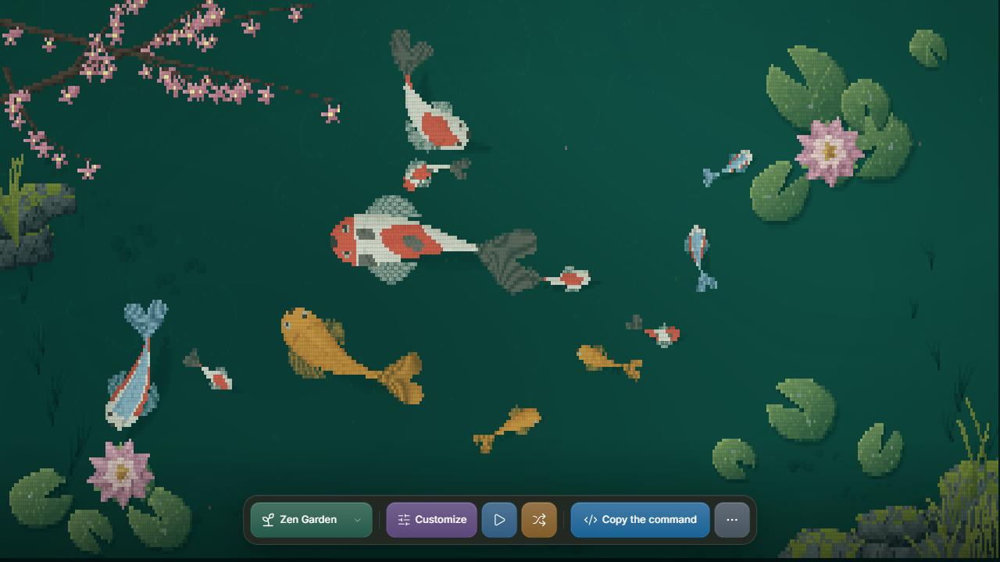

# Koi Pond

[](https://github.com/dhruvil-codes/koi-pond/actions/workflows/ci.yml)

An interactive ASCII koi pond for websites and portfolios. Embed it as a custom element or mount it on a canvas you manage. The embed has no runtime dependencies and makes no network requests.



[Open the live playground](https://koi-pond.bydhruvil.in)

## Add the pond to a page

### Static HTML, no build step

Download the [v0.4.2 source archive](https://github.com/dhruvil-codes/koi-pond/archive/refs/tags/v0.4.2.zip). Copy `dist/koi-pond.iife.js` from the archive into your site's files, then add a script and element:

```html
<script src="./koi-pond.iife.js"></script>
<koi-pond
  environment="zen"
  fish-count="12"
  style="display:block;height:480px"
></koi-pond>
```

The script registers `<koi-pond>` when it loads. The element defaults to 480px tall; set its height to suit your layout. Once copied, the embed runs offline.

### Install from GitHub for JavaScript apps

The package is named `@dhruvil-codes/koi-pond`, but it has not been published to the npm registry. Install the source tag with Node.js 22 or newer, npm and Git:

```sh
npm install git+https://github.com/dhruvil-codes/koi-pond.git#v0.4.2
```

Installation uses the committed builds, so it does not build the playground or install its development dependencies. The package includes an ESM entry, TypeScript declarations and the classic browser build. Use the ESM entry when your app owns a canvas; use the classic build for a direct script embed.

## Mount a canvas

Create the controller after the canvas is in the document and has a CSS size. Destroy it when the canvas leaves the page.

```js
import { createKoiPond } from '@dhruvil-codes/koi-pond';

const canvas = document.querySelector('#pond');
const pond = createKoiPond(canvas, { environment: 'sakura', fishCount: 8 });

pond.feed(0.5, 0.5);
```

```html
<canvas id="pond" aria-label="Interactive koi pond" style="display:block;width:100%;height:480px"></canvas>
```

`feed` and `ripple` take normalized coordinates from `0` to `1`. Call `setOptions({ ... })` to update settings without replacing the pond. Call `pond.destroy()` when your app removes the canvas to release its animation, listeners and observers. See the [API reference](docs/API.md) for all methods and settings.

## React and Next.js

Import the library from a client component. Create it once per effect lifecycle, update it when props change, and destroy it during cleanup. This keeps prop changes from restarting the simulation.

```jsx
'use client';

import { useEffect, useRef } from 'react';
import { createKoiPond } from '@dhruvil-codes/koi-pond';

export function Pond({ environment = 'zen', fishCount = 12 }) {
  const canvasRef = useRef(null);
  const pondRef = useRef(null);

  useEffect(() => {
    const pond = createKoiPond(canvasRef.current);
    pondRef.current = pond;
    return () => {
      pond.destroy();
      pondRef.current = null;
    };
  }, []);

  useEffect(() => {
    pondRef.current?.setOptions({ environment, fishCount });
  }, [environment, fishCount]);

  return <canvas ref={canvasRef} aria-label="Interactive koi pond"
    style={{ display: 'block', width: '100%', height: 480 }} />;
}
```

Next.js projects need the `'use client'` boundary for effects and canvas interaction. Importing the ESM entry does not access browser globals during module loading, but call `createKoiPond` only in the browser. The full [React example](examples/ReactPond.jsx) shows the same lifecycle with additional settings. More guidance is in [Integrations](docs/INTEGRATIONS.md).

React, Next.js, Kumo and ReUI are playground or example development dependencies. They are not runtime dependencies of the pond library.

## Decorative background

For a pond behind page content, disable interaction, hide the decorative canvas from assistive technology, and keep text on a contrasting surface. The [portfolio example](examples/portfolio.html) shows a fixed background canvas:

```js
KoiPond.createKoiPond(document.querySelector('#pond-background'), {
  environment: 'zen',
  interactive: false,
});
```

The library is about 78 KB unminified and uses no remote images or other network assets. Keep a decorative canvas away from links and buttons so it cannot intercept input.

## Environments and settings

The five preset environment IDs are:

| ID | Scene |
| --- | --- |
| `zen` | Zen Garden |
| `moonlight` | Moonlight |
| `autumn` | Autumn |
| `sakura` | Sakura Spring |
| `daylight` | Daylight |

Changing the environment preserves the fish settings and motion. For example, use fewer fish, a custom water color, and balanced rendering:

```js
const pond = createKoiPond(canvas, {
  environment: 'autumn',
  fishCount: 8,
  waterColor: '#174b55',
  waterClarity: 0.7,
  detail: 'balanced',
});
```

`setOptions()` accepts partial settings. The custom element uses kebab-case attributes such as `fish-count`, `water-clarity` and `interactive="false"`. Use the controller for array settings such as `varieties`. Values are validated before they are applied. The [API reference](docs/API.md#settings) lists defaults, accepted values and all methods.

## Interaction and motion

- Move or touch the pond to stir the water. Click or tap to feed the fish.
- The playground dock has scene selection, controls, reset, randomize and share actions. Choose More, then Quiet view to hide the dock. Escape restores it or closes an open panel.
- When the page is hidden or the pond is offscreen, animation pauses. It resumes when visible again if the pond is still set to play.
- If the operating system requests reduced motion, the pond starts paused. The user can choose Play.
- `detail: 'fine'` is the default. `detail: 'balanced'` lowers rendering detail. The renderer also caps work based on fish count and size and can lower its refresh rate on slower hardware.

The canvas embed allows vertical page scrolling by default. For a full-screen canvas where gestures should stir in every direction, set `canvas.style.touchAction = 'none'` before mounting. See [API](docs/API.md#canvas-controller) for the touch behavior and lifecycle details.

With the interactive pond focused:

| Key | Action |
| --- | --- |
| Arrow keys | Move the feeding cursor |
| Enter | Drop food at the cursor |
| Space | Pause or resume |
| R | Restart motion with the current settings |

## Sharing configuration

The playground's share link encodes normalized settings and the seed in the URL hash. `serializeConfig()` and `parseConfig()` provide the same versioned JSON format for apps:

```js
import { parseConfig, serializeConfig } from '@dhruvil-codes/koi-pond';

const json = serializeConfig({ environment: 'autumn', seed: 42 });
const settings = parseConfig(json);
```

The seed makes the configuration and initial layout repeatable. A shared link starts a new simulation; it does not save a screenshot or the later motion timeline.

## Troubleshooting

**The pond is blank.** Give the custom element or canvas a nonzero CSS height and width. For example, use `height: 480px` and `width: 100%`. Check that the script or ESM import loaded and, for a manual canvas, that `createKoiPond()` runs after it is mounted.

**An ESM import fails from a local HTML file.** Use the classic `dist/koi-pond.iife.js` build for a page opened from disk, or serve the page from a local web server.

**The npm install command fails.** This project is not on the npm registry. Use the GitHub install command above and check that Node.js 22+ and Git are available.

Browser checks cover Chromium, Firefox and Playwright WebKit, including six viewport sizes and emulated touch input. Physical Safari/iOS/Android devices and full screen-reader behavior still need separate verification. See [testing and compatibility](docs/TESTING.md) for exact versions and coverage.

## Development and checks

Use Node.js 22 or newer for development. The [contributor guide](CONTRIBUTING.md) has setup instructions, browser commands and evidence locations.

```sh
npm ci
npm run build:all
npm test
npm run check:types
```

The browser playground is available in `index.html`. For deployment setup, see the [deployment guide](docs/DEPLOYMENT.md). The [testing notes](docs/TESTING.md) record browser evidence and known coverage limits. See [third-party notices](docs/THIRD-PARTY-NOTICES.md) for playground UI licenses.

## License

MIT. See [LICENSE](LICENSE).
