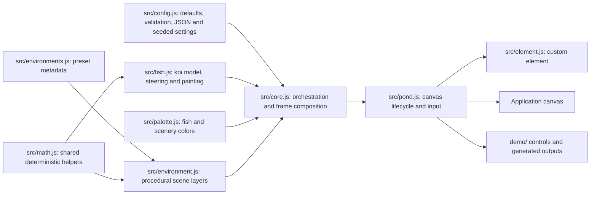

# Project map

The pond simulation, environment artwork, browser lifecycle and playground are separate layers. Hosts can use the same simulation without adopting the playground.

| Location | Responsibility |
| --- | --- |
| `src/config.js` | Defaults, atomic validation, cloned normalized settings, versioned JSON serialization/parsing and seeded randomization. |
| `src/fish.js` | Fish creation, articulated steering, advancing, resizing and fish-only painting. |
| `src/environment.js` | Procedural water, lighting, rocks, vegetation, blossoms, lilies, lotuses, particles and atmosphere. It does not own fish behavior or mutate fish. |
| `src/environments.js` | Canonical preset metadata for Zen Garden, Moonlight, Autumn and Sakura Spring. |
| `src/palette.js` | Stable fish and plant colors; the environment module appends its own scenery ramps. |
| `src/math.js` | Shared clamp, wrap, hash and ramp helpers. |
| `src/core.js` | Simulation orchestration and ordered back-environment, fish and foreground composition. No DOM. |
| `src/pond.js` | Canvas sizing, painting, pointer and keyboard input, visibility handling, lifecycle and public controller. |
| `src/element.js` | Custom-element attributes, local shadow styles, mount/disconnect and error events. |
| `types/index.d.ts` | Public TypeScript contracts and custom-element/event types. |
| `demo/App.tsx` and `demo/styles.css` | Fullscreen React playground, bottom dock, live controls, import/share links and developer outputs. |
| `demo/components/ui/` | ReUI Radix primitives with upstream MIT attribution; actions use the installed Cloudflare Kumo Button. |
| `demo/snippets.js` | Framework integration snippets and the versioned GitHub installation command. |
| `examples/` | Direct HTML embed, decorative background and React lifecycle examples. |
| `scripts/build.mjs` | ESM/classic library assembly and self-contained playground generation with esbuild and Tailwind. |
| `dist/` and `index.html` | Committed browser outputs for immediate use; rebuild from source instead of hand-editing. |
| `test/` | Simulation, environment, artwork, configuration, lifecycle and build checks. |
| `integrations/t3/` | Isolated experimental Windows adapter and its version guards. |

The library outputs contain only the pond engine and browser controller. Playground-only React and component packages are development dependencies; their minified code and styles are inlined into `index.html`. The page has no external scripts, styles, fonts or images and can be opened offline. Each settings panel uses the same controller; opening controls or changing the environment does not recreate the pond. The browser check opens this file directly, without a server.

## State and interaction

Each controller owns one pond, animation clock and set of observers. A canvas cannot have two live controllers. Removing a custom element destroys its controller; reconnecting starts a new one. A manually managed canvas must call `destroy()` when its host removes it.

Options are normalized and validated as one change before they are applied. Environment-only changes preserve fish object references, positions, spine points, speeds and kinds, along with food and simulation time. Population changes retain survivors. The explicit `reset()` method restarts motion with current settings; `resetToDefaults()` restores settings. Seeded settings and initial layouts are repeatable.

Pointer movement creates ripples, while a tap feeds after pointer-up confirms it was not a drag. Keyboard controls act only while the pond has focus. The renderer pauses when hidden or offscreen and respects reduced-motion preference. Fine and balanced detail settings bound the character grid; actual rendering performance still depends on hardware and scene settings.

Static water, rocks and vegetation are cached separately from fish. Dirty canvas cells redraw only when their character, material or coverage changes. Water material edges align to device pixels, while fish keep their fine character texture. Higher counts and sizes lower the grid ceiling; consistently slow frames can reduce the refresh rate to 30 Hz while elapsed-time steering preserves swimming speed.

## Extending it

The four selectable presets are `zen`, `moonlight`, `autumn` and `sakura`. Legacy configuration ids `midnight`, `rain` and `dusk` are accepted for compatibility, but are not additional preset choices. Environment artwork is procedural and deterministic for a given normalized configuration and simulation state.

For a new environment, add metadata and palette treatment in the environment modules, validate any new setting, update the playground and public types, and cover state continuity. Keep environment rendering from mutating fish or simulation state. For a new fish behavior, update the fish and core layers. Host integrations should reuse the canvas controller, keep their own lifecycle cleanup, and state which platforms have been checked.

Run the checks in [Contributing](../CONTRIBUTING.md), then rebuild source and committed outputs together. The [API](API.md) documents public behavior; [SPEC](SPEC.md) records the 0.2 scope and [Roadmap](ROADMAP.md) tracks future work.
