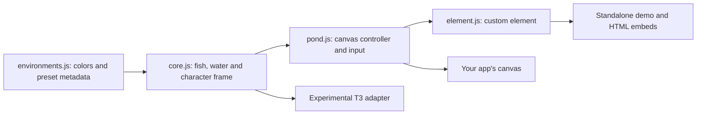

# Project map

The simulation, browser lifecycle and demo are separate. A host app can use the same pond without adopting the demo controls.

| Location | Responsibility |
| --- | --- |
| `src/core.js` | Deterministic fish steering, articulated spines, food, bounded ripples and procedural ASCII artwork. No DOM. |
| `src/environments.js` | Frozen preset metadata and palettes. Midnight is the original artwork. |
| `src/pond.js` | Canvas sizing, drawing, pointer/keyboard input, lifecycle, accessibility and public controller. |
| `src/element.js` | Custom-element attributes, local shadow styles, mount/disconnect and error events. |
| `types/index.d.ts` | Public TypeScript contracts and custom-element/event types. |
| `demo/` | Controls and layout for the standalone playground. |
| `scripts/build.mjs` | Deterministic, dependency-free ESM/classic bundling and inline demo generation. |
| `dist/` and `index.html` | Committed output so a download works immediately. Rebuild rather than edit these. |
| `examples/` | A minimal working drop-in HTML example. |
| `test/` | Simulation, artwork, lifecycle and build checks. Generated browser fixture is ignored by Git. |
| `integrations/t3/` | Optional Windows adapter, process/version guards and reversible archive patching. |
| `.local/` | Local-only prior experiments and backups; ignored by Git and excluded from packages. |

## State and interaction

Every controller owns one simulation, one animation clock and its observers. A canvas cannot have two live controllers. Removing a custom element destroys its controller; reconnecting starts a new one. Manually managed canvases must call `destroy()` when their host removes them.

`setOptions()` validates the entire change before applying it. Environment and speed changes preserve positions, food and time. Population changes keep surviving fish. Reset restores the scene with the current options. Public snapshots are frozen and contain no mutable simulation objects.

Pointer movement produces throttled, velocity-sensitive ripples. A tap feeds only after pointer-up confirms that it was not a drag. Movement stays marked as a drag even if it returns to its starting point. Touch cancellation and secondary pointers cannot feed. Keyboard controls act only while the canvas has focus.

The renderer uses elapsed time and small simulation substeps. Hidden/offscreen ponds stop scheduling frames and reset their timestamp before resuming. Fine detail caps the character grid at 480 columns, balanced at 300, and DPR at two. These bounds keep work predictable; performance still depends on hardware, population and weather.

## Extending it

For a new environment, add metadata and a palette in `src/environments.js`, add any time-derived ambient artwork in `src/core.js`, and update validation, types, demo controls and tests. Keep the default Midnight palette intact. Avoid randomness inside rendering so a frame is reproducible.

For a new behavior, change the core and add a deterministic simulation check. For a new host integration, reuse the canvas controller or core; isolate host-specific code and document its verified platform/version. Do not inject global styles or copy the physics into each adapter.

Run the checks in [CONTRIBUTING](../CONTRIBUTING.md), rebuild, then commit the source and generated files together. The build test and CI catch stale distributables.

The [Roadmap](ROADMAP.md) tracks future work; the [release spec](SPEC.md) defines what is implemented now.
